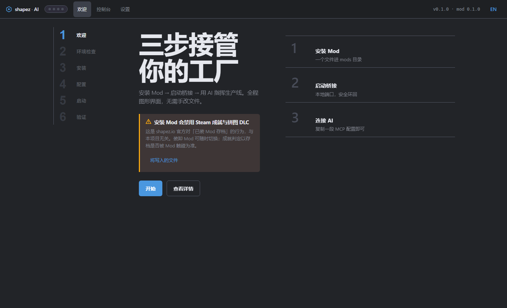

[English](README.md) | [简体中文](README.zh-CN.md)

<div align="center">

# shapez-ai-bridge

**Turn a running shapez.io factory into something a program can drive**
A single-file official mod + a zero-dependency local bridge + an MCP server


**Zero npm dependencies** · **Binds to 127.0.0.1 only** · **No game code included**

**[⬇️ Download the latest build](https://github.com/sqkl520/shapez-ai-bridge/releases)** ·
[Protocol contract](docs/PROTOCOL.md) ·
[Report a problem](https://github.com/sqkl520/shapez-ai-bridge/issues)

</div>

> ⚠️ **This is an early snapshot, not a stable release**
> The bridge, the mod and the MCP server all work end to end. **The closed-loop agent
> cannot yet build a production line on its own.** What works and what does not is laid
> out in "Current status" below — that section does not round anything up.
>
> **The version lives on the [Releases page](https://github.com/sqkl520/shapez-ai-bridge/releases)**,
> not in this README.

---

## ✨ What it can do

Observe the factory, place and delete buildings, fast-forward deterministically,
export and paste blueprints, and snapshot savegames — all over local HTTP and
WebSocket, so any script or MCP client can drive it.

**Observe**
```bash
curl -s http://127.0.0.1:7777/rpc -H "Content-Type: application/json" \
  -d '{"jsonrpc":"2.0","id":1,"method":"obs","params":{"max_entities":5,"include_hub":true}}'
```
You get entities with stable uids, hub stock, the current goal, the camera and stats.
Clip big factories with `region` and `max_entities`; over the limit it returns
`truncated: true` **with the full `stats` still included** — it never silently cuts.

**Act** — place, delete, lay paths, set speed, move the camera:
```bash
curl -s http://127.0.0.1:7777/rpc -H "Content-Type: application/json" \
  -d '{"jsonrpc":"2.0","id":1,"method":"act","params":{"op":"place","building":"belt","x":5,"y":5}}'
```

**Deterministic fast-forward** — advance N logic ticks synchronously, using the same
loop the game's own puzzle validator runs:
```bash
curl -s http://127.0.0.1:7777/rpc -H "Content-Type: application/json" \
  -d '{"jsonrpc":"2.0","id":1,"method":"act","params":{"op":"step","ticks":600,"collect":true}}'
```

**Blueprints** — export any region as a portable `SZBP1.*` string and paste it back
anywhere:
```bash
curl -s http://127.0.0.1:7777/rpc -H "Content-Type: application/json" \
  -d '{"jsonrpc":"2.0","id":1,"method":"act","params":{"op":"export_blueprint","region":[0,0,10,10]}}'
```

**Savegame snapshots** — save, keep a named copy on the bridge side, roll back any time:
```bash
curl -s http://127.0.0.1:7777/rpc -H "Content-Type: application/json" \
  -d '{"jsonrpc":"2.0","id":1,"method":"snapshot_save","params":{"name":"before-big-build"}}'
```

**MCP** — everything above exposed as **12 MCP tools**
(`shapez_status`, `shapez_observe`, `shapez_action`, `shapez_batch`,
`shapez_screenshot`, `shapez_blueprint`, `shapez_save`, `shapez_load`,
`shapez_world`, `shapez_resources`, `shapez_items`, `shapez_production`):
```bash
echo '{"jsonrpc":"2.0","id":1,"method":"tools/list"}' | node src/mcp/server.mjs
```

The full protocol contract — methods, error codes, observation schema — is in
[`docs/PROTOCOL.md`](docs/PROTOCOL.md).

## 🚀 Quick start

**Prerequisites**: Node.js ≥ 20, shapez.io desktop 1.5.6 (Steam), and a checkout of
this repository.

**1. Install the mod (one command)**

Windows (PowerShell):
```powershell
powershell -ExecutionPolicy Bypass -File install.ps1
```
macOS / Linux:
```bash
bash install.sh
```

**2. Start the bridge**
```bash
node src/bridge/bridge.mjs
```

**3. Open the game, load any savegame, then check it**
```bash
node scripts/smoke_test.mjs
```
Expected: `SMOKE TEST PASSED (5/5)`. The test briefly places and deletes one belt near
the hub to prove writes work — your world is left unchanged.

### Prefer a GUI?

No commands at all: double-click `gui/start.cmd` (Windows) and a wizard checks the
environment, installs the mod, writes the config, starts the bridge and verifies it —
with live logs, and an explicit fix when something is missing. You never edit a config
file by hand.



```bash
node gui/server.mjs          # or double-click gui/start.cmd on Windows
```

It opens a chromeless window on `http://127.0.0.1:7801/`. Same zero-dependency rules as
the rest of the project — it needs only Node and a browser. Walkthrough in
[gui/README.md](gui/README.md).

Everything below is the command-line path — the GUI drives exactly the same scripts, so
the two are interchangeable.

## ❓ FAQ

| Question | Answer |
|---|---|
| I can't connect | ① Is the bridge up? `curl -s http://127.0.0.1:7777/health` should return `{"ok":true,...}`; `Connection refused` means it is not. ② Is the game open? `mod_connected:true` appears only once the game is running **with the mod loaded**. ③ Is the mod in the right place? It must be a **single `.js` file directly in that folder**, not a subfolder; the game logs `Loaded N mods` on startup and N must be ≥ 1. ④ A firewall or proxy that blocks localhost breaks both the bridge listener and the mod's WebSocket — allow `127.0.0.1:7777`, and exclude `127.0.0.1` from any forced system proxy |
| Version mismatch (error `1002`) | The bridge refused the handshake because the game version is not in `compat.json`. This is a **hard fail by design** — building codes and internal APIs are version-specific. Switch to a mod/bridge version that lists your game build, or move the game back to a supported build via Steam betas. **There is no override flag** |
| Observation is empty or errors | `1003 not_in_game` means you are in the main menu or still loading — load a savegame and `status` reports `in_game:true`. `region:[x0,y0,x1,y1]` is an **inclusive** bounding box; anything outside is filtered out, and omitting it observes the bounding box of all entities. Entities live on `regular` or `wires`; the default is `regular` |
| My MCP client does not list the tools | The path in the client config must be **absolute** and point at `src/mcp/server.mjs`; in JSON on Windows use forward slashes (`C:/...`) or escaped backslashes (`C:\\...`). Restart the client after editing. Test it standalone: `echo '{"jsonrpc":"2.0","id":1,"method":"tools/list"}' \| node src/mcp/server.mjs` should print one JSON line listing **12** tools. The server logs to stderr, not stdout — check your client's MCP logs |
| Did I lose Steam achievements? | Yes, if any mod is installed. The game only enables its Steam layer with zero mods loaded. Official behaviour, not something this project adds |
| Can I undo a build? | Yes — `snapshot_save` keeps a named copy on the bridge side and `snapshot_load` restores it. Note that a save the mod has touched is marked as modified, which **disables the DLC for that save** |

## 🔧 How it works

```
┌─ shapez.io (Electron) ───────────────────┐
│  shapez-ai-bridge.js                     │   the mod is a WebSocket *client*
│  (official single-file mod, no Node)  ───┼──▶ ws://127.0.0.1:7777/mod
└──────────────────────────────────────────┘
              │
┌─────────────┴────────────────────────────┐
│  bridge.mjs  (Node, zero dependencies)   │
│  ├─ WS   /mod     ← game mod             │
│  ├─ WS   /client  ← tools / event stream │
│  └─ HTTP /health  /status  /rpc  ← curl  │
└─────────────┬────────────────────────────┘
              │ HTTP or stdio
┌─────────────┴──────────┬─────────────────┐
│  mcp/server.mjs        │  agent/play.mjs │
│  12 MCP tools          │  reference agent│
└────────────────────────┴─────────────────┘
```

**Why a separate bridge process?** shapez.io's renderer is sandboxed
(`nodeIntegration:false`, `sandbox:true`), so an in-game mod has no file or socket APIs —
but the browser's native `WebSocket` client is always available. The mod dials out to a
small Node process on your machine; that process owns the HTTP API, the MCP server and
the snapshot files.

### Tech stack

| Layer | What it uses |
|---|---|
| mod | Single-file JS through the game's own `METADATA` / `Mod` / `ModInterface` / `window.shapez` |
| bridge | Node ≥ 20, **zero npm dependencies**, hand-written WebSocket |
| transport | JSON-RPC 2.0 over HTTP, plus a bidirectional WS event stream |
| blueprints | Own `SZBP1.*` format, reusing the game's own LZ-string compression |
| GUI | Plain Node HTTP server + framework-free frontend, palette taken from the game |
| tests | `node --test` (677 passing) + bridge selftest 19 + MCP selftest 97 |

## 📌 Current status

> No rounding up. What works and what does not, item by item.

| Module | Status |
|---|---|
| mod ↔ bridge ↔ MCP end to end | ✅ Working on real shapez.io 1.5.6 |
| Observe / act / fast-forward / blueprints / snapshots | ✅ All usable, including `dry_run` preflight |
| Offline layout compiler (target shape → line blueprint) | ✅ Works, see below |
| GUI setup wizard | ✅ Works, screenshot above |
| **Closed-loop agent (observe → decide → build → verify)** | ⬜ **Cannot yet build a production line from scratch.** Measured output at level 12 is persistently 0 |
| `1.0.0` | ⬜ Waiting on "builds a line from scratch and delivers it into the hub" |

**Quality baseline**: 677 unit tests passing · bridge selftest 19/19 · MCP selftest 97/97.

### Build a production line from a target shape

`src/ai/` contains a layout compiler: give it a goal shape and it plans a working
production line offline, then hands you a blueprint that pastes and delivers.

```bash
node src/ai/compiler/cli.mjs --goal "CuCuCuCu" --seed 43391 --hub -2,-2 --json
```

It runs the whole chain with no game running: recipe solver → offline resource map (the
world is a pure function of `map.seed`) → row layout → belt routing with explicit
`(rotation, rotationVariant)` → ten-check validator → SZBP1 blueprint.

**`--hub` is required.** Without it the compiler can only invent a hub location, so the
collection belt feeds empty ground. A compile whose hub is not pinned is reported as a
failure (`class: "hub:unpinned"`), not a success. Pass the hub's real top-left corner as
observed from the game (`obs`), not a guessed coordinate.

`ok: true` means the plan is internally consistent and reaches the real hub **when pasted
onto empty ground**. It does not mean the target area is empty: the compiler is offline
and does not read your save, so it cannot see what is already built there. Always
`dry_run` the paste first — that is the check that sees the world.

| | |
|---|---|
| Goals that build | `CuCuCuCu`, `RuRuRuRu`, `SuSuSuSu`, `----CuCu`, `RuRu----`, `Cu----Cu`, `Cu------`, `--CuCu--`, `Ru----Ru`, `--SuSu--`; painted goals when the map allows it: `CrCrCrCr` (119 entities), `RbRb----` (262 entities, needs `--range 200`) |
| Not yet | `CpCpCpCp` and `CgScScCg` — these need three or more miners on one row at fixed spacing, and no such resource pattern exists near the hub on seed 43391 (honestly reported as `no-resource-in-range`). Multilayer goals are out of scope by design (`scope.layers: 1`) |

**Painted goals are map-permitting, not unconditional.** The row layout puts every miner
on one row at a fixed pitch, so a painted goal needs the world to offer its ore in exactly
that pattern. `CrCrCrCr` needs `Cu` with `red` four cells west; on seed 43391 that pattern
occurs twice in a 512×512 window. Other seeds may have none — the compiler says
`no-resource-in-range` rather than producing a line that starves.

**Safety rules the compiler enforces:**

- **Refuses a plan that would land on existing buildings.** Only belts and wires are
  replaceable in shapez; pasting over one silently destroys it, and pasting over a machine
  half-builds the line while still reporting success. `paste_blueprint` therefore has a
  `dry_run` that reports `would_apply` / `would_delete` / `blocked` before anything happens.
- **Refuses corners that would flip.** A belt's turn is recomputed from its neighbours, so
  a corner must be a fixed point of that recomputation; when no original rotation makes it
  one, the plan fails instead of producing a line that breaks later.
- **Never pastes into a dirty region.** v1 builds on fresh ground only; it refuses a world
  containing non-hub entities. But it only sees a world if you hand it one, so `dry_run`
  remains the authoritative check.
- **Refuses a plan whose hub is unknown.** Without `--hub` the collector belt terminates at
  an invented coordinate; such a compile returns `ok: false` and `class: "hub:unpinned"`
  instead of a blueprint.

The build ledger is [`research/ai-plan/BATCH.md`](research/ai-plan/BATCH.md); the research
behind it is [`research/ai-player/SYNTHESIS.md`](research/ai-player/SYNTHESIS.md).

`research/` holds the working notes from building this — measurement scripts, live-run
transcripts, design arguments, and the record of what was tried and rejected. It is **not**
user documentation and you do not need it to use the tool; it is public so the claims in
this README are checkable rather than taken on trust.

## ⚠️ Known limitations

An honest list. Why each one follows from how the game works is in
[`PHASE0-RECON.md`](PHASE0-RECON.md).

- **Steam achievements are disabled while ANY mod is installed.** The game only enables its Steam layer when zero mods are loaded. Official behaviour, not a bug of this project.
- **The game clears its session storage on every launch**, so the mod has no cross-session local storage. Anything persistent must go through mod settings files or the savegame.
- **shapez.io 1.5.6 has no native blueprint string format.** This project defines its own `SZBP1.*` (built on the game's own LZ-string), so blueprints are only exchangeable between the same game version — the embedded `gv` field is checked on paste and a mismatch fails with `2006`.
- **Pasting a blueprint charges "blueprint shape" material** (`CbCbCbRb:CwCwCwCw` in regular mode) per the game's own cost formula. `charge:false` pastes for free.
- **`step` / `await` fast-forward runs synchronously on the render thread** — large tick counts briefly freeze the screen. A single step is capped at 20,000 ticks.
- **Observations of big factories must be clipped** with `region` and/or `max_entities`. Over-limit observations report `truncated: true` and always include full `stats` — never a silent cut.
- **Desktop only** (Windows / macOS / Linux Electron builds). The mobile and browser versions of shapez.io do not support mods.
- **`new_game` needs a fresh game process.** After a very long uptime the game can wedge in the menu: the save is created but the state machine never enters the world. Restart the game and it works.
- **The layout compiler's output is god-mode.** It uses `charge:false` and does not check building unlock levels, so it can place a stacker at level 2. The acceptance target (`CuCuCuCu`) needs only the level-1 cutter, so it holds under either reading, but any "cleared level N" claim from the compiler is a god-mode claim.
- **The compiler builds on fresh ground only.** It refuses to place over existing buildings (v1), so extending a running factory is not supported yet.
- **The closed-loop agent does not work yet.** It can observe, call macros and verify its own results, but it cannot yet complete the full mine → mix → stack → deliver-to-hub chain within a single run. Measured output at level 12 is persistently 0.

## 📦 Build and verify

```bash
npm test                  # 677 unit tests
npm run selftest:bridge   # bridge layer selftest (19 checks)
npm run selftest:mcp      # MCP layer selftest (97 checks)
npm run smoke             # end to end (needs the game and bridge running)
```

The smoke test is fully non-interactive by default. Exit codes: `0` pass, `1` bridge not
running, `2` game not in a world, `3` another check failed. `SHAPEZ_SMOKE_AUTOPLAY=1`
suppresses the notice about the temporary belt. Override the bridge address with `--url` /
`SHAPEZ_BRIDGE_URL`, and authenticate with `--token` / `SHAPEZ_BRIDGE_TOKEN`.

### Directory layout

| Path | What it is |
|---|---|
| `src/mod/shapez-ai-bridge.js` | The in-game mod — a single file loaded by the official mod loader |
| `src/bridge/bridge.mjs` | Zero-dependency Node bridge: WS `/mod` + `/client`, HTTP `/health` `/status` `/rpc`, snapshot management |
| `src/mcp/server.mjs` | MCP stdio server (12 tools), forwarding to the bridge's HTTP API |
| `src/agent/play.mjs` | Reference agent driving the bridge over HTTP |
| `src/ai/compiler/` | The offline layout compiler |
| `src/shared/` | Vendored lz-string + the `SZBP1` blueprint codec |
| `scripts/smoke_test.mjs` | Zero-dependency end-to-end smoke test |
| `docs/PROTOCOL.md` | The frozen protocol contract — the single source of truth |
| `compat.json` | Machine-readable compatibility matrix |
| `test/` | Layer selftests (mod RPC in a Node sandbox, lz-string interop, blueprint round-trips) |
| `gui/` | Setup wizard and configuration UI |

## 🤝 Development and contributing

An early project. The code is not beautiful, but every fix is pinned by a test.

- **Contributing**: [`CONTRIBUTING.md`](CONTRIBUTING.md) — how to report a problem, how to send a PR, build and test rules.
- **Security**: [`SECURITY.md`](SECURITY.md) — use the **private channel** (GitHub Security Advisories), not a public issue.
- **Reporting a bug**: include the version, your Node version, your OS, reproduction steps, and expected vs actual behaviour. The template asks for each.

## ⚖️ License and credits

This project's code is **MIT** — see [`LICENSE`](LICENSE); third-party notices are in
[`THIRD-PARTY-NOTICES.md`](THIRD-PARTY-NOTICES.md).

- Vendored [lz-string](https://github.com/pieroxy/lz-string) 1.4.5: © 2013 Pieroxy,
  **MIT / WTFPL** dual-licensed. It compresses blueprints and mirrors the game's own
  savegame compression.
- **This repository contains no shapez.io game code or assets.** All integration goes through the
  game's official mod API. shapez.io is © [tobspr Games](https://shapez.io).
  One qualification worth stating plainly: [`test/fixtures/`](test/fixtures/) holds a copy of
  **lz-string**, which the game vendors unmodified — it is © Pieroxy under MIT/WTFPL, not
  tobspr Games' code, and it exists only so the interop test can check our codec against the
  implementation the game actually uses. See [`THIRD-PARTY-NOTICES.md`](THIRD-PARTY-NOTICES.md).
- This is an **unofficial community project**, not affiliated with, endorsed by, or
  supported by tobspr Games. Please do not report problems with this mod to them.

## ⭐ Star History

<a href="https://www.star-history.com/?repos=sqkl520%2Fshapez-ai-bridge&type=date&legend=top-left">
 <picture>
   <source media="(prefers-color-scheme: dark)" srcset="https://api.star-history.com/chart?repos=sqkl520%2Fshapez-ai-bridge&type=date&theme=dark&legend=top-left" />
   <source media="(prefers-color-scheme: light)" srcset="https://api.star-history.com/chart?repos=sqkl520%2Fshapez-ai-bridge&type=date&theme=light&legend=top-left" />
   
 </picture>
</a>
