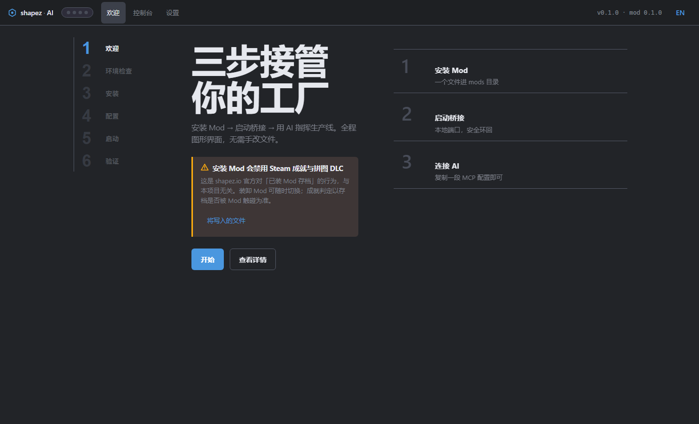

[English](README.md) | 简体中文

<div align="center">

# shapez-ai-bridge

**把一个正在运行的 shapez.io 工厂变成可以被程序驱动的东西**
单文件官方 mod + 零依赖本地桥 + MCP 服务器


**零 npm 依赖** · **只监听 127.0.0.1** · **不含任何游戏代码**

**[⬇️ 下载最新版](https://github.com/sqkl520/shapez-ai-bridge/releases)** ·
[协议契约](docs/PROTOCOL.md) ·
[问题反馈](https://github.com/sqkl520/shapez-ai-bridge/issues)

</div>

> ⚠️ **这是一个早期快照，不是稳定发布**
> 桥接层、mod、MCP 服务器都已跑通；**闭环 agent 还没能自己在关卡里建成一条产线**。
> 具体哪里能用、哪里不能用，见下面「当前进度」—— 这一节不修饰。
>
> **版本以 [Releases 页](https://github.com/sqkl520/shapez-ai-bridge/releases) 为准**，
> 本 README 不单独维护版本号。

---

## ✨ 它能做什么

观察工厂、放置和删除建筑、确定性地快进、导出与粘贴蓝图、存取存档快照 ——
全部通过本地 HTTP / WebSocket，任何脚本或 MCP 客户端都能驱动。

**观测**
```bash
curl -s http://127.0.0.1:7777/rpc -H "Content-Type: application/json" \
  -d '{"jsonrpc":"2.0","id":1,"method":"obs","params":{"max_entities":5,"include_hub":true}}'
```
拿到实体（带稳定 uid）、hub 库存、当前目标、相机、统计。大工厂用 `region` 和
`max_entities` 裁剪；超限时返回 `truncated: true` 并始终带上全量 `stats` ——
**不会静默截断**。

**动作** —— 放置、删除、铺路径、设速度、移相机：
```bash
curl -s http://127.0.0.1:7777/rpc -H "Content-Type: application/json" \
  -d '{"jsonrpc":"2.0","id":1,"method":"act","params":{"op":"place","building":"belt","x":5,"y":5}}'
```

**确定性快进** —— 同步推进 N 个逻辑 tick，走的是游戏自己的 puzzle 校验循环：
```bash
curl -s http://127.0.0.1:7777/rpc -H "Content-Type: application/json" \
  -d '{"jsonrpc":"2.0","id":1,"method":"act","params":{"op":"step","ticks":600,"collect":true}}'
```

**蓝图** —— 任意区域导出成可移植的 `SZBP1.*` 字符串，再贴回任何地方：
```bash
curl -s http://127.0.0.1:7777/rpc -H "Content-Type: application/json" \
  -d '{"jsonrpc":"2.0","id":1,"method":"act","params":{"op":"export_blueprint","region":[0,0,10,10]}}'
```

**存档快照** —— 存档并在桥接侧保留一份命名副本，随时回滚：
```bash
curl -s http://127.0.0.1:7777/rpc -H "Content-Type: application/json" \
  -d '{"jsonrpc":"2.0","id":1,"method":"snapshot_save","params":{"name":"before-big-build"}}'
```

**MCP** —— 以上全部封装成 **12 个 MCP 工具**
（`shapez_status` / `shapez_observe` / `shapez_action` / `shapez_batch` /
`shapez_screenshot` / `shapez_blueprint` / `shapez_save` / `shapez_load` /
`shapez_world` / `shapez_resources` / `shapez_items` / `shapez_production`）：
```bash
echo '{"jsonrpc":"2.0","id":1,"method":"tools/list"}' | node src/mcp/server.mjs
```

完整协议契约（方法、错误码、观测 schema）见 [`docs/PROTOCOL.md`](docs/PROTOCOL.md)。

## 🚀 快速开始

**环境**：Node.js ≥ 20、shapez.io 桌面版 1.5.6（Steam）、本仓库的一份 checkout。

**1. 装 mod（一条命令）**

Windows（PowerShell）：
```powershell
powershell -ExecutionPolicy Bypass -File install.ps1
```
macOS / Linux：
```bash
bash install.sh
```

**2. 起桥**
```bash
node src/bridge/bridge.mjs
```

**3. 开游戏、载入任意存档，然后自检**
```bash
node scripts/smoke_test.mjs
```
期望输出 `SMOKE TEST PASSED (5/5)`。这个自检会在 hub 附近临时放一条带子再删掉，
证明写入可用 —— 你的世界不会被改动。

### 想要图形界面？

不用敲任何命令：双击 `gui/start.cmd`（Windows），向导会检查环境、装 mod、
写配置、起桥、验证，全程有实时日志，缺什么就直接告诉你。配置文件一次都不用手改。



```bash
node gui/server.mjs          # 或者 Windows 下双击 gui/start.cmd
```

它会在 `http://127.0.0.1:7801/` 打开一个无边框窗口。和项目其余部分同一套
零依赖规则 —— 只需要 Node 和一个浏览器。走查见 [gui/README.md](gui/README.md)。

下面都是命令行路径 —— GUI 驱动的完全是同一批脚本，两者等价。

## ❓ 常见问题

| 问题 | 解法 |
|---|---|
| 连不上 | ① 桥起了吗？`curl -s http://127.0.0.1:7777/health` 应返回 `{"ok":true,...}`，`Connection refused` 就是没起。② 游戏开了吗？`mod_connected:true` 只在游戏开着**且 mod 已加载**时出现。③ mod 位置对不对？必须是该目录下**单个 `.js` 文件**（不能是子文件夹），游戏启动时日志会打 `Loaded N mods`，N 必须 ≥ 1。④ 防火墙/代理拦截了 localhost 的话，给 `127.0.0.1:7777` 放行，或把 `127.0.0.1` 排除出系统代理 |
| 版本不匹配（error `1002`） | 桥拒掉握手，因为游戏版本不在 `compat.json` 的兼容表里。这是**设计上的硬失败** —— 建筑编码和内部 API 是版本相关的。换一个列出了你这版游戏的 mod/桥版本，或用 Steam beta 把游戏切回受支持的构建。**没有 override 开关** |
| 观测是空的 / 报错 | `1003 not_in_game` 说明还在主菜单或仍在加载，载入存档即可，`status` 会变成 `in_game:true`。`region:[x0,y0,x1,y1]` 是**含边界**的包围盒，外面的一律滤掉；不传就用全部实体的包围盒。实体分 `regular` 和 `wires` 两层，默认看 `regular` |
| MCP 客户端里看不到工具 | 客户端配置里的路径必须是**绝对路径**且指向 `src/mcp/server.mjs`；Windows 上 JSON 里用正斜杠（`C:/...`）或转义反斜杠（`C:\\...`）。改完要重启客户端。单独测：`echo '{"jsonrpc":"2.0","id":1,"method":"tools/list"}' \| node src/mcp/server.mjs` 应输出一行列出 **12** 个工具的 JSON。服务器日志走 stderr 不走 stdout，去客户端的 MCP 日志里看 |
| Steam 成就是不是没了 | 只要你装了**任何** mod，成就就关。游戏只在零 mod 时启用 Steam 层。这是官方行为，不是本项目加的 |
| 存档能反悔吗 | 能。`snapshot_save` 在桥接侧留命名副本，`snapshot_load` 还原。但注意：载入过 mod 的存档会被游戏标记为已修改，**该存档的 DLC 会关闭** |

## 🔧 它是怎么工作的

```
┌─ shapez.io (Electron) ───────────────────┐
│  shapez-ai-bridge.js                     │   mod 是 WebSocket *客户端*
│  (官方单文件 mod，不需要 Node)      ─────┼──▶ ws://127.0.0.1:7777/mod
└──────────────────────────────────────────┘
              │
┌─────────────┴────────────────────────────┐
│  bridge.mjs  (Node，零依赖)               │
│  ├─ WS   /mod     ← 游戏 mod              │
│  ├─ WS   /client  ← 工具 / 事件流         │
│  └─ HTTP /health  /status  /rpc  ← curl   │
└─────────────┬────────────────────────────┘
              │ HTTP 或 stdio
┌─────────────┴──────────┬─────────────────┐
│  mcp/server.mjs        │  agent/play.mjs │
│  12 个 MCP 工具         │  参考 agent      │
└────────────────────────┴─────────────────┘
```

**为什么要单独一个桥进程？** shapez.io 的渲染进程是沙箱化的
（`nodeIntegration:false`、`sandbox:true`），所以游戏内 mod 拿不到文件和 socket API ——
但浏览器的原生 `WebSocket` 客户端永远可用。mod 主动外拨到本机一个小 Node 进程，
由那个进程持有 HTTP API、MCP 服务器和快照文件。

### 技术栈

| 层 | 用了什么 |
|---|---|
| mod | 单文件 JS，走游戏官方的 `METADATA` / `Mod` / `ModInterface` / `window.shapez` |
| 桥 | Node ≥ 20，**零 npm 依赖**，WebSocket 手写实现 |
| 通信 | JSON-RPC 2.0 over HTTP，以及 WS 双向事件流 |
| 蓝图 | 自建 `SZBP1.*` 格式，复用游戏自己的 LZ-string 压缩 |
| GUI | 原生 Node HTTP 服务器 + 无框架前端，配色取自游戏本身 |
| 测试 | `node --test`（677 通过）+ 桥自检 19 项 + MCP 自检 97 项 |

## 📌 当前进度

> 这一节不修饰。哪些能用、哪些不能用，逐条列清楚。

| 模块 | 状态 |
|---|---|
| mod ↔ 桥 ↔ MCP 端到端 | ✅ 在 shapez.io 1.5.6 真机上跑通 |
| 观测 / 动作 / 快进 / 蓝图 / 快照 | ✅ 全部可用，含 `dry_run` 预检 |
| 离线布局编译器（给定目标形状 → 产线蓝图） | ✅ 可用，见下节 |
| GUI 安装向导 | ✅ 可用，截图见上 |
| **闭环 agent（自己观察 → 决策 → 施工 → 验证）** | ⬜ **尚不能从零建成一条产线**。第 12 关实测产出恒为 0 |
| `1.0.0` | ⬜ 待「能自动从零建成一条产线并交付进 hub」 |

**质量基线**：677 单测全过 · 桥自检 19/19 · MCP 自检 97/97。

### 从目标形状建一条产线

`src/ai/` 里有一个布局编译器：给它一个目标形状，它离线规划出一条能用的产线，
交给你一张贴上去就能产出的蓝图。

```bash
node src/ai/compiler/cli.mjs --goal "CuCuCuCu" --seed 43391 --hub -2,-2 --json
```

全程不需要游戏在跑：配方求解 → 离线资源图（世界是 `map.seed` 的纯函数）→
行布局 → 显式 `(rotation, rotationVariant)` 的带子路由 → 十项校验 → SZBP1 蓝图。

**`--hub` 是必填的。** 不给的话编译器只能自己编一个 hub 位置，收集带就会喂到空地上。
hub 没钉住的编译按失败上报（`class: "hub:unpinned"`），不会假装成功。hub 坐标要从
游戏里真实观测（`obs`）拿左上角，别猜。

`ok: true` 的含义是「计划自洽，且在**贴着空地贴上去时**能到真实 hub」，
**不**代表那块地是空的 —— 编译器离线运行，不读你的存档，看不到那里已经有什么。
所以贴之前一定要先 `dry_run`，那才是看得见世界的检查。

| | |
|---|---|
| 能建的目标 | `CuCuCuCu`、`RuRuRuRu`、`SuSuSuSu`、`----CuCu`、`RuRu----`、`Cu----Cu`、`Cu------`、`--CuCu--`、`Ru----Ru`、`--SuSu--`；地图允许时的上色目标：`CrCrCrCr`（119 实体）、`RbRb----`（262 实体，需要 `--range 200`） |
| 还不能 | `CpCpCpCp` 和 `CgScScCg` —— 这些需要同一行上按固定间距排三个以上矿机，而 seed 43391 的 hub 附近没有这种资源图案（如实报 `no-resource-in-range`）。多层目标按设计不在范围内（`scope.layers: 1`） |

**上色目标是「地图允许才行」，不是无条件的。** 行布局把所有矿机排在同一行、固定间距，
所以上色目标要求世界恰好按这个图案提供矿石。`CrCrCrCr` 需要 `Cu` 且 `red` 在其西侧
四格；seed 43391 上这个图案在 512×512 窗口内出现两次。别的种子可能一次都没有 ——
编译器会说 `no-resource-in-range`，而不是吐一条会饿死的产线。

**编译器强制的安全规则：**

- **拒绝落到已有建筑上的计划。** shapez 里只有带子和电线是可替换的；贴到带子上会**静默销毁**它，
  贴到机器上则是逐条目拒绝但其余照放（建出半条线）。`paste_blueprint` 因此有 `dry_run`，
  在动手前报 `would_apply` / `would_delete` / `blocked`。
- **拒绝会翻转的拐角。** 带子的转向由邻居重算，所以拐角必须是这个重算的**不动点**；
  没有任何原始转向能成为不动点时，计划失败，而不是产出一条过一会儿才坏的线。
- **不往脏区域贴。** v1 只在空地上建。只要世界里存在非 hub 实体就拒绝 ——
  但它只有在有人递给它世界快照时才看得见，所以 `dry_run` 仍然是权威检查。
- **hub 不明就拒绝出图。** 没有 `--hub` 时收集带会终止在一个编出来的坐标上，
  这种编译返回 `ok: false` 和 `class: "hub:unpinned"`，不返回蓝图。

构建台账见 [`research/ai-plan/BATCH.md`](research/ai-plan/BATCH.md)，
背后的研究见 [`research/ai-player/SYNTHESIS.md`](research/ai-player/SYNTHESIS.md)。

`research/` 是搭建这个项目过程里的工作笔记 —— 测量脚本、真机运行记录、设计论证，
以及「试过什么、为什么否掉」。它**不是**用户文档，用这个工具不需要看它；
之所以公开，是因为 README 里的结论应该可核查，而不是让你只能选择相信。

## ⚠️ 已知限制

一条一条列清楚。每一条**为什么**成立，见 [`PHASE0-RECON.md`](PHASE0-RECON.md)。

- **装了任何 mod，Steam 成就就会关。** 游戏只在零 mod 时启用 Steam 层。这是官方行为，不是本项目的 bug。
- **游戏每次启动都会清掉 session storage**，所以 mod 没有跨会话的本地存储。要持久化只能走 mod 设置文件或存档。
- **shapez.io 1.5.6 没有原生蓝图字符串格式。** 本项目自建 `SZBP1.*`（建立在游戏自己的 LZ-string 上），所以蓝图只能在同一游戏版本间交换 —— 内嵌的 `gv` 字段在粘贴时会校验，不匹配报错 `2006`。
- **贴蓝图要扣「蓝图形状」材料**（regular 模式下是 `CbCbCbRb:CwCwCwCw`），按游戏自己的费用公式。`charge:false` 可以免费贴。
- **`step` / `await` 快进同步跑在渲染线程上** —— tick 数大时会短暂卡屏。单次上限 20,000 tick。
- **大工厂的观测必须裁剪**，用 `region` 和/或 `max_entities`。超限返回 `truncated: true`，且始终带全量 `stats` —— 绝不静默截断。
- **只支持桌面版**（Windows / macOS / Linux Electron 构建）。手机版和网页版 shapez.io 不支持 mod。
- **`new_game` 需要一个新起的游戏进程。** 开机很久之后游戏可能卡在菜单里：存档建出来了但状态机没进世界。重启游戏即可。
- **布局编译器的产出是 god-mode。** 它用 `charge:false` 且不检查建筑解锁等级，所以能在第 2 关放一个 stacker。验收目标（`CuCuCuCu`）只需要 1 级切割机，两种读法下都成立，但编译器给出的任何「通了第 N 关」都是 god-mode 意义上的。
- **编译器只在空地上建。** 它拒绝在已有建筑上放置（v1），所以还不支持扩建正在运行的工厂。
- **闭环 agent 还不行。** 它已经能观察、能调用宏、能自己验证结果，但还无法在一个 run 内把 挖矿 → 混合 → 堆叠 → 送 hub 这条完整链路接通。第 12 关产出恒为 0。

## 📦 构建与验证

```bash
npm test                  # 677 单测
npm run selftest:bridge   # 桥接层自检（19 项）
npm run selftest:mcp      # MCP 层自检（97 项）
npm run smoke             # 端到端（需要游戏 + 桥在跑）
```

冒烟测试默认完全非交互，退出码 `0` 通过 / `1` 桥没起 / `2` 游戏不在世界里 / `3` 其它检查失败。
`SHAPEZ_SMOKE_AUTOPLAY=1` 会压掉「临时放了一条带子」的提示。
用 `--url` / `SHAPEZ_BRIDGE_URL` 改桥地址，用 `--token` / `SHAPEZ_BRIDGE_TOKEN` 认证。

### 目录结构

| 路径 | 是什么 |
|---|---|
| `src/mod/shapez-ai-bridge.js` | 游戏内 mod —— 单文件，由官方 mod 加载器读取 |
| `src/bridge/bridge.mjs` | 零依赖 Node 桥：WS `/mod` + `/client`，HTTP `/health` `/status` `/rpc`，快照文件管理 |
| `src/mcp/server.mjs` | MCP stdio 服务器（12 个工具），转发到桥的 HTTP API |
| `src/agent/play.mjs` | 参考 agent，通过 HTTP 驱动桥 |
| `src/ai/compiler/` | 离线布局编译器 |
| `src/shared/` | 内置的 lz-string + `SZBP1` 蓝图编解码 |
| `scripts/smoke_test.mjs` | 零依赖端到端冒烟测试 |
| `docs/PROTOCOL.md` | 冻结的协议契约 —— 唯一真源 |
| `compat.json` | 机器可读的兼容矩阵 |
| `test/` | 各层自检（Node 沙箱里的 mod RPC、lz-string 互操作、蓝图往返） |
| `gui/` | 安装向导与配置界面 |

## 🤝 开发与贡献

早期项目，代码不算漂亮，但每一处修复都有测试钉着。

- **贡献指南**：[`CONTRIBUTING.md`](CONTRIBUTING.md) —— 怎么报问题、怎么提 PR、构建与测试要求。
- **安全问题**：[`SECURITY.md`](SECURITY.md) —— **走私密渠道**（GitHub Security Advisories），不要开公开 issue。
- **报 bug 请带上**：版本、Node 版本、操作系统、复现步骤、期望行为与实际行为。模板会逐项要求。

## ⚖️ 许可与致谢

本项目代码以 **MIT** 发布，见 [`LICENSE`](LICENSE)；第三方组件声明见
[`THIRD-PARTY-NOTICES.md`](THIRD-PARTY-NOTICES.md)。

- 内置 [lz-string](https://github.com/pieroxy/lz-string) 1.4.5：© 2013 Pieroxy，
  **MIT / WTFPL** 双许可。用来压缩蓝图，并镜像游戏自己的存档压缩。
- **本仓库不含任何 shapez.io 游戏代码或素材。** 所有集成都走游戏官方 mod API。
  shapez.io 版权归 [tobspr Games](https://shapez.io)。
  有一点值得说明白：[`test/fixtures/`](test/fixtures/) 里有一份 **lz-string** 的副本，
  游戏是原样 vendor 它的 —— 该文件版权属 Pieroxy，MIT/WTFPL 双许可，不是 tobspr Games 的代码，
  放在那里只是为了让互操作测试能拿我们的编解码器和游戏实际用的那份实现对拍，
  见 [`THIRD-PARTY-NOTICES.md`](THIRD-PARTY-NOTICES.md)。
- 这是一个**非官方社区项目**，与 tobspr Games 无隶属、背书或支持关系。
  请不要把这个 mod 的问题反馈给他们。

## ⭐ Star History

<a href="https://www.star-history.com/?repos=sqkl520%2Fshapez-ai-bridge&type=date&legend=top-left">
 <picture>
   <source media="(prefers-color-scheme: dark)" srcset="https://api.star-history.com/chart?repos=sqkl520%2Fshapez-ai-bridge&type=date&theme=dark&legend=top-left" />
   <source media="(prefers-color-scheme: light)" srcset="https://api.star-history.com/chart?repos=sqkl520%2Fshapez-ai-bridge&type=date&legend=top-left" />
   
 </picture>
</a>
